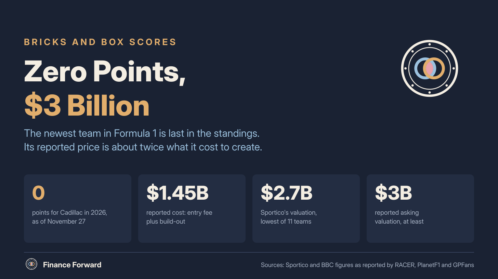
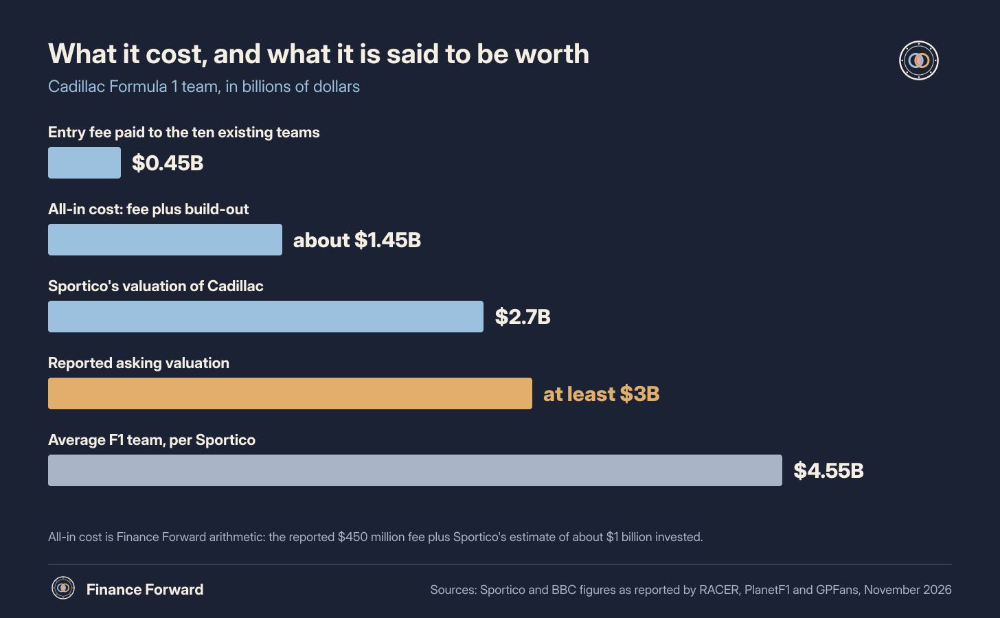

# Zero Points, $3 Billion: What the Cadillac F1 Price Is Really For

- Column: Bricks and Box Scores
- Subtitle: The newest team on the Formula 1 grid has not scored a point and is reported to be heading for a loss of about $400 million. The reported asking price is still about twice what it cost to create.
- Drafted and fact-checked: November 27, 2026. Published by Abhi on Substack the same night.
- This is the text as it left the fact-check. The published version on Substack is the record; Abhi may have edited "My view" and added a teaser line.
- Images and their spec: `article-images/bricks-2026-11-27/`

---

------------------------------------------------------------------------

<figure>

</figure>

**The asset in one line:** a stake in the Cadillac Formula 1 team, described in most reports as controlling, the 11th and newest entry on the grid, run by TWG Motorsports in partnership with General Motors and reported by Sportico on November 2 to be on the market at a valuation of at least \$3 billion.

Most of what I write in this column is about buildings and the teams that play in them. This week the building is a parking space. Formula 1 has room for a limited number of teams, and until this season there were ten. Cadillac became the eleventh at the start of this season, and before its first year has finished its owner is reported to be selling.

The numbers look strange next to each other. As of November 27, with the season finale in Abu Dhabi on December 6 still to come, Cadillac sits last of 11 teams with zero points. Sportico reports that the team is on track to lose about \$400 million this year. The same outlet reports that Mark Walter's TWG is seeking a valuation of at least \$3 billion, with at least seven interested parties. TWG said in August that it was not considering a sale and has since said that a sale is not imminent, so everything about the process here comes from press reports and not from the seller. Most reports give \$3 billion as the value of the whole team, though at least one describes it as the price of the stake; I treat it as the whole team, which is the kinder reading for a buyer.

I think the price makes more sense, and the risk becomes clearer, once you stop treating this as a racing team and start treating it as a piece of scarce land with a half-finished building on it.

### The investor lens

Start with what it cost. To join, the team paid an anti-dilution fee that the BBC reported at \$450 million, more than double the \$200 million fee that applied before. That money did not buy a factory or a car. It went to the ten existing teams, about \$45 million each by my arithmetic (\$450 million divided by ten), as compensation for splitting the prize fund eleven ways. Sportico estimates that roughly another \$1 billion went into establishing the team, which RACER says included heavy spending on facilities in Silverstone, Indianapolis and Charlotte. Add the two and the all-in cost is about \$1.45 billion. One outlet, Jalopnik, describes the \$1 billion as including the fee; I use Sportico's estimate as relayed by RACER.

At a \$3 billion valuation, a buyer is paying about twice what the team cost to create, for an operation that is last in the standings and reported to be losing money. On the reported numbers there is no profit to value yet. So the investor's question is not what the team earns but what has to be true for \$3 billion to work.

Here is a simple illustration. Suppose a buyer wants a 10% annual return over five years and the team needs no further capital, which is generous for a team at the back. Three billion dollars compounding at 10% for five years is about \$4.8 billion. Sportico's November valuations put the average Formula 1 team at \$4.55 billion today. In other words, the last-place team has to become worth more than today's average team within five years, before counting a single dollar of the losses a new owner would fund along the way.

That is not impossible. Sportico's average rose 33% in the past year, and its figure for Haas, a small team, is \$2.8 billion. But it means the buyer is underwriting two things at once: that team values across the sport keep climbing, and that this team climbs the grid. The first is a bet on Formula 1. Only the second is a bet on Cadillac.

### The advisor lens

From the advisor's seat, cost is the wrong yardstick, and I think that is the heart of how a sale like this would be pitched. A twelfth team cannot simply be built for \$1.45 billion, because a new entry needs the sport's approval and, on the reports I have read, no further slot is on offer. RACER notes that the original Andretti-branded attempt was rebuffed by the sport before the version backed by General Motors was approved. The asset is the right to be on the grid, and there are eleven of those.

So the valuation method is comparables, not cash flow. Sportico values Cadillac at \$2.7 billion, the lowest of the 11 teams, and the reported ask of at least \$3 billion sits about 11% or more above that. The case for the price writes itself from recent history. Williams was sold in 2020 for €152 million according to Bloomberg, about \$180 million, and Sportico now values it at \$3.24 billion. An investor group bought into Alpine in 2023 at a valuation of roughly \$900 million, and Sportico now puts that team at \$3.28 billion. Against those, \$3 billion can be presented as today's entry ticket and not as a premium.

<figure>

<figcaption>What Cadillac cost to create against what it is said to be worth. Figures are press reports; the all-in cost is my arithmetic.</figcaption>
</figure>

Three structural points matter more than the headline. First, it is not clear from the reports exactly what is being sold. Most describe a controlling stake, while The Race reports that the seller's preference appears to be a minority sale that keeps control. The Race also puts the ownership at 67% for Mark Walter, 30% for General Motors and 3% for Dan Towriss, figures it says have not been publicly confirmed. Second, the name on the car belongs to General Motors, not to the seller, and so does the planned in-house engine. A buyer would be acquiring a team whose identity depends on a partner that is not reported to be part of the sale. Third, the process has reportedly tightened and then loosened: Front Office Sports reported that Fenway Sports Group held an exclusive negotiating window that expired without an extension, with talks continuing. A lapsed exclusivity is not a failed deal, but it can mean the two sides are still apart on price or terms.

### Where the two lenses disagree

The investor looks at \$1.45 billion in, zero points and a loss of about \$400 million, and sees a price that assumes success that has not happened yet. The advisor looks at eleven slots, a rejected earlier applicant and a run of comparables, and sees the cheapest way onto the grid that exists. Both are reading the same facts. They disagree about whether a new team should be priced on what it cost to build or on what it would cost to be shut out.

### My view

I mostly agree with the advisor that replacement cost is the wrong measure here. Scarcity is real, and the fee is the clearest evidence of it, because ten competitors reportedly shared \$450 million to accept one more. Where I part ways is on how much of that scarcity a buyer should pay for today. The slot is the land. The team is the building, and the building is not finished. A price at least 11% above the lowest valuation in the sport, for a team still at the back, asks the buyer to pay a finished-building price and then fund the construction. The detail I would weigh most is not the \$3 billion. It is what General Motors has agreed to do, for how long, and whether that agreement survives a change of owner. I fully expect the answer to that question to move the price more than any lap time will.

### Takeaway

When an asset loses money and still commands a premium to its cost, ask what the buyer actually ends up owning. Here it is one of eleven places on a grid that rarely adds another. Before judging any price like this, separate the land from the building: what is scarce, what still has to be built, and who pays for the building.

### Sources

- [RACER, Nov 3, 2026](https://racer.com/2026/11/03/twg-group-exploring-sale-of-cadillac-f1-team): Sportico's report of the sale and \$3 billion valuation, at least seven interested parties, the fee and the \$1 billion estimate, facilities, the August TWG statement
- [Motorsport Week, Nov 4, 2026](https://www.motorsportweek.com/2026/11/04/cadillac-f1-team-owner-reportedly-considering-sale/): the loss of about \$400 million and zero points
- [Crash.net, Nov 3, 2026](https://www.crash.net/f1/news/1109288/1/cadillac-f1-team-owner-evaluating-3-billion-sale-after-sudden-u-turn): controlling stake, at least seven potential buyers
- [PlanetF1, Nov 26, 2024](https://www.planetf1.com/news/general-motors-cadillac-entry-fee-f1-2026-cost) and [The Race, Nov 25, 2024](https://www.the-race.com/formula-1/everything-we-know-about-new-cadillac-f1-entry-without-andretti/): the \$450 million fee reported by the BBC, the earlier \$200 million fee, the split among ten teams
- [GPFans on Sportico's November 2026 valuations](https://www.gpfans.com/en/f1-news/1092849/f1-team-valuations-november-2026-sportico/): Cadillac, Haas, Williams, Alpine and the average; Alpine's 2023 valuation
- [European Business Magazine, Nov 23, 2026](https://europeanbusinessmagazine.com/cadillac-seeks-3bn-for-f1-team): second outlet for the valuations and the Williams and Alpine history
- [grandprix.com, Aug 24, 2020](https://www.grandprix.com/news/williams-was-sold-for-eur-152-million.html): Bloomberg's €152 million figure for the Williams sale
- [The Race, Nov 6, 2026](https://www.the-race.com/business/cadillac-f1-buyout-talks-what-is-really-happening/): the reported ownership split and the reported preference for a minority sale
- [Field Level Media, Nov 21, 2026](https://fieldlevelmedia.com/formula-1/report-fsg-remains-in-cadillac-f1-talks-after-window-lapses/) and [F1-Fansite](https://www.f1-fansite.com/f1-news/cadillac-sale-talks-now-hit-snag-after-fenway-exclusivity-lapses/): the Front Office Sports report on the lapsed exclusivity; [F1-Fansite on the Guardian report](https://www.f1-fansite.com/f1-news/fenway-sports-group-reportedly-in-talks-over-cadillac-f1-stake/): TWG's statement that a sale is not imminent
- [RacingNews365 constructors' standings](https://racingnews365.com/f1/standings/2026/teams), read Nov 27, 2026
- [Jalopnik, Nov 4, 2026](https://www.jalopnik.com/2306791/cadillac-f1-up-for-sale-one-year/): the alternative reading of the \$1 billion figure

Sportico's own pages could not be opened for this piece, so its figures are cited through the outlets above.

**Disclosure:** I hold no position in General Motors or any other company mentioned.

*Finance Forward is for education and discussion only. Nothing here is investment advice or a recommendation to buy, sell or hold any security. Views are my own and do not represent any employer or organization.*
